<div align="center">
  
  <h3>The editor you know, rebuilt in Rust.</h3>
</div>

---

This is [Neovim](https://github.com/neovim/neovim) with its entire C codebase and CMake build system replaced by Rust and Cargo.

It is a drop-in replacement for upstream Neovim, not a from-scratch rewrite with missing features. Your `init.lua`, keymaps, colorschemes, LSP servers, and plugins work without changes.

### What stays the same

- **Full plugin compatibility**: If a Lua or Vimscript plugin works in Neovim, it works here too—unmodified—on the same embedded LuaJIT runtime and editor API.
- **Built-in LSP, Treesitter, and diagnostics**: Ships with the same `runtime/` standard library (`vim.lsp`, `vim.treesitter`, `vim.diagnostic`) and tracks upstream `neovim/neovim` continuously.
- **External GUIs and RPC clients**: Speaks the exact same Msgpack-RPC protocol, so graphical frontends, language hosts, and remote plugins connect without changes.
- **Every Vim feature you rely on**: Macros, registers, marks, folds, diff mode, spell checking, quickfix, terminal buffers, and `:help`.

### What changed under the hood

- **Memory-safe Rust core with zero `.c` or `.h` files**: The entire editor core (`src/nvim/`) plus formerly vendored C libraries (`libvterm`, `libtermkey`, `unibilium`, `libmpack`, `lua-cjson`, `LPeg`, `xdiff`, `xxd`, `tee`) are native Rust (`edition = "2024"`), with `unsafe` confined strictly to C-ABI boundaries.
- **Multi-core parallelism where C is single-threaded**: Heavy workloads—including buffer-wide search (`:vimgrep`, `:global`), fuzzy file and symbol matching (`matchfuzzy`), side-by-side diff alignment (`linematch`), spell suggestions, and swap serialization—scale automatically across CPU cores.
- **Faster in-memory data structures**: Replaces C linked lists, linear scans, and 4KB pointer-paged line tables with contiguous Rust vectors, chunked line storage, and fast hash tables—speeding up soft-wrapping, virtual-text motion, option updates, and autocommand handling.
- **Pre-compiled built-in Lua runtime**: Core `runtime/lua/` modules are compiled to LuaJIT bytecode at build time, reducing startup and module-load overhead.
- **Single-command Cargo build**: No CMake, Ninja, or Luarocks bootstrap. `cargo xtask install` builds and installs the editor in one step, validated against the full functional, legacy Vim, Rust unit, and Miri lifetime test suites across Linux, macOS, and Windows.

## Performance

Measured head-to-head against retail (`CMAKE_BUILD_TYPE=Release`) builds of upstream [`neovim/neovim@d9a842e291`](https://github.com/neovim/neovim/commit/d9a842e291) (`v0.13.0-dev`) on identical hardware across **Linux** (GCC `Release` vs. `rustc --release`) and **Windows** (MSVC `Release` vs. `rustc --release`) using 3 interleaved runs via `cargo xtask benchmark --compare`:

<p align="center">
  
</p>

<details>
<summary><strong>View full benchmark table &amp; methodology</strong></summary>

| Workload | Suite | Linux C | Linux Rust | Speedup | Windows C | Windows Rust | Speedup |
|---|---|---:|---:|---:|---:|---:|---:|
| Cold startup (`--clean --headless +q`, 25-run median) | Startup | 4.30 ms | 5.84 ms | 0.74x | 45.25 ms | 31.66 ms | 1.43x |
| Screen layout & wrapping (24 tests) | screenpos | 23.98 s | 16.20 s | 1.48x | 30.23 s | 17.00 s | 1.78x |
| Long ASCII line layout (median) | screenpos | 3.32 µs | 1.50 µs | 2.21x | 70.10 µs | 1.70 µs | 41.24x |
| Long UTF-8 line layout (median) | screenpos | 98.10 µs | 80.51 µs | 1.22x | 105.80 µs | 74.50 µs | 1.42x |
| Regex search (backtracking) | regexp | 2.36 ms | 1.93 ms | 1.22x | 4.82 ms | 2.42 ms | 1.99x |
| Regex search (auto engine) | regexp | 3.31 ms | 4.03 ms | 0.82x | 6.70 ms | 5.50 ms | 1.22x |
| Cursor motion over 2k virtual lines | extmark | 62.24 µs | 35.63 µs | 1.75x | 67.30 µs | 52.90 µs | 1.27x |
| Treesitter fold navigation (100 macros) | treesitter | 14.26 ms | 17.81 ms | 0.80x | 60.73 ms | 48.09 ms | 1.26x |
| Treesitter redraw suite (8 tests) | treesitter | 913 ms | 1105 ms | 0.83x | 1621 ms | 1447 ms | 1.12x |
| Autocmd lifecycle suite (10k events) | autocmd | 125.0 ms | 103.7 ms | 1.20x | 469.9 ms | 298.6 ms | 1.57x |
| Delete 10k autocmds (unique patterns) | autocmd | 21.21 ms | 0.98 ms | 21.74x | 29.84 ms | 1.74 ms | 17.12x |
| Extmark & virtual line suite | extmark | 104.2 ms | 116.3 ms | 0.90x | 226.8 ms | 200.9 ms | 1.13x |
| Option updates (140k calls) | option | 220.4 ms | 204.9 ms | 1.08x | 582.0 ms | 384.1 ms | 1.52x |
| Full-screen Treesitter redraw (100x50) | decor | 14.20 ms | 14.60 ms | 0.97x | 16.00 ms | 15.80 ms | 1.01x |

**Methodology**:
- **Speedup**: Relative speedup of the Rust port compared to upstream C (`C time ÷ Rust time`; values `> 1.00x` mean Rust is faster, and `< 1.00x` mean C is faster).
- Both repositories are checked out at the exact same synced upstream commit (`MAINTAIN.md`) on the same filesystem (`ext4` on Linux; NTFS on Windows).
- Upstream C is built from source with `-DCMAKE_BUILD_TYPE=Release` (`-O3 -DNDEBUG` on Linux GCC; `/O2 /Ob2 /DNDEBUG` on Windows MSVC).
- The Rust port is built with `cargo xtask build --release` (`opt-level = 3`, `lto = "thin"`).
- Benchmarks are executed across 3 interleaved rounds (`cargo xtask benchmark --compare --update-readme`) and the median of the 3 rounds is reported.

</details>

## Quick Start

### Install a pre-built release

Pre-built archives and installers for Windows (`.zip`, `.msi`), macOS (`.tar.gz`), and Linux (`.tar.gz`, `.appimage`) are published on the [Releases](https://github.com/freddiehaddad/neovim/releases) page. See [INSTALL.md](./INSTALL.md) for platform instructions.

### Build and install from source

With Rust (`1.88+`) and a system C compiler installed (used once to build the bundled `libuv`, `LuaJIT`, `luv`, and `tree-sitter` archives in `.deps/`), building and installing is a single command:

```bash
cargo xtask install
```

To install to a custom prefix:

```bash
cargo xtask install --prefix /custom/path
```

Common `cargo xtask` commands (see [BUILD.md](./BUILD.md) for full details):

```bash
cargo xtask build --release   # build optimized binaries and stage runtime in target/nvim-build/
cargo xtask dist              # build release archives (.tar.gz / .zip / .appimage / .msi)
cargo xtask unittest          # run Rust unit tests
cargo xtask functionaltest    # run the Lua functional test suite
cargo xtask oldtest           # run the legacy Vim test suite
cargo xtask benchmark         # run the performance benchmark suite
cargo xtask lint              # run clippy, stylua, error-code, and vimdoc linters
```

## Project Layout

```text
├─ runtime/            Built-in Lua modules (vim.lsp, vim.treesitter, ...), syntax, and :help docs
├─ src/
│  ├─ nvim/            Neovim core in Rust
│  │  ├─ api/          Nvim API & RPC endpoints (nvim_buf_*, nvim_win_*, nvim_extmark_*, ...)
│  │  ├─ eval/         Vimscript evaluator & built-in functions
│  │  ├─ event/        Async event loop & process/pty management (libuv)
│  │  ├─ lua/          LuaJIT runtime bridge & Treesitter C API bindings
│  │  ├─ msgpack_rpc/  Msgpack-RPC channel, packer, and unpacker
│  │  ├─ os/           Platform filesystem, environment, signal, and shell abstractions
│  │  ├─ tui/          Terminal UI renderer, termkey input driver, and terminfo parser
│  │  ├─ viml/         Vimscript parser & expression lexer
│  │  └─ vterm/        Rust port of libvterm
│  ├─ cjson/           Rust port of lua-cjson
│  ├─ lpeg/            Rust port of LPeg
│  ├─ mpack/           Rust port of libmpack / lmpack
│  ├─ xdiff/           Rust port of git xdiff
│  ├─ gen/             Documentation & metadata generators
│  ├─ tee/             Rust tee helper binary
│  ├─ xxd/             Rust xxd hex dump utility
│  └─ xtask/           Cargo build, test, benchmark, lint, and packaging runner
└─ test/
   ├─ functional/      Lua functional & RPC test suites
   ├─ old/             Legacy Vimscript test suites
   ├─ benchmark/       Performance benchmark suites
   └─ event-lifetimes/ Miri callback & handle lifetime test crate
```

## Contributing & Maintenance

- [PORTING.md](./PORTING.md): Porting strategy, pitfalls encountered, and lessons learned.
- [BUILD.md](./BUILD.md): Prerequisites, platform build instructions, and `cargo xtask` reference.
- [CONTRIBUTING.md](./CONTRIBUTING.md): Workflow, testing, linting, and pull request guidelines.
- [MAINTAIN.md](./MAINTAIN.md): Upstream `neovim/neovim` sync process and release packaging.
- [AGENTS.md](./AGENTS.md): Architecture, soundness invariants, and rules for AI coding agents.

## License

Neovim contributions since [`b17d96`](https://github.com/neovim/neovim/commit/b17d9691a24099c9210289f16afb1a498a89d803) are licensed under the Apache 2.0 license, except for contributions ported from Vim. See [LICENSE.txt](./LICENSE.txt) for details.

